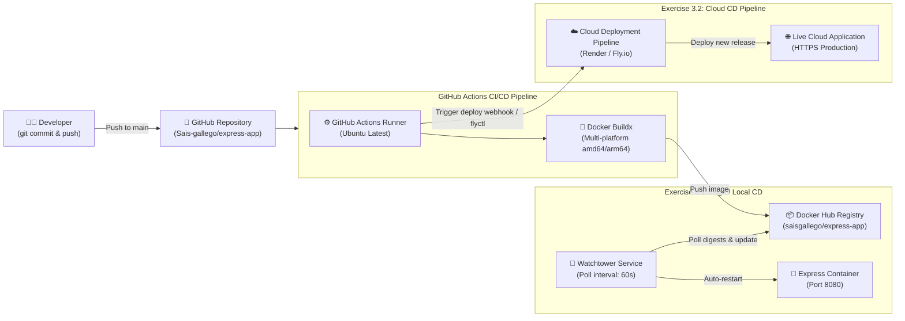

# 🐳 DevOps with Docker — Express Deployment Pipeline

[](https://github.com/Sais-gallego/express-app/actions/workflows/pipeline.yml)
[](https://github.com/Sais-gallego/express-app/actions/workflows/cloud-deploy.yml)
[](https://hub.docker.com)
[](https://watchtower.nickfedor.com)
[](https://nodejs.org)
[](LICENSE)

> **Course:** [DevOps with Docker (Fall 2026)](https://courses.mooc.fi/org/uh-cs/courses/devops-with-docker-fall-2026)  
> **Institution:** Department of Computer Science, University of Helsinki (*Helsingin Yliopisto*) & MOOC.fi  
> **Author / Student:** Sergio Andrés Ipuz Saavedra ([@Sais-gallego](https://github.com/Sais-gallego))  
> **Exercises Covered:**  
> - **Exercise 3.1: Your pipeline (GitHub Actions + Docker Hub + Watchtower)**  
> - **Exercise 3.2: Deployment pipeline to a cloud service**

---

## 🌐 Live Deployed Application

* 🚀 **Production Cloud URL:** [https://devops-with-docker.mooc.fi/](https://devops-with-docker.mooc.fi/)
* 📦 **Docker Hub Image:** [`saisgallego/express-app:latest`](https://hub.docker.com/r/saisgallego/express-app)
* 🐙 **GitHub Repository:** [https://github.com/Sais-gallego/express-app](https://github.com/Sais-gallego/express-app)

---

## 📌 Architectural Overview

This project provides an automated, zero-touch Continuous Integration and Continuous Deployment (CI/CD) pipeline for containerized applications, fulfilling both local edge deployment and cloud production delivery.



---

## 🛠️ Exercise 3.1: Your Pipeline (GitHub Actions + Watchtower)

### 1. The GitHub Actions Workflow (`.github/workflows/pipeline.yml`)

Every push to the `main` branch triggers an automated build using the latest official Docker actions:

```yaml
name: Release Node.js app

on:
  push:
    branches:
      - main
  workflow_dispatch:

jobs:
  build:
    name: Build and Push Docker Image
    runs-on: ubuntu-latest
    steps:
      - name: Checkout repository
        uses: actions/checkout@v4

      - name: Set up QEMU
        uses: docker/setup-qemu-action@v3

      - name: Set up Docker Buildx
        uses: docker/setup-buildx-action@v3

      - name: Log in to Docker Hub
        uses: docker/login-action@v3
        with:
          username: ${{ secrets.DOCKER_USERNAME }}
          password: ${{ secrets.DOCKER_PASSWORD }}

      - name: Build and push Docker image
        uses: docker/build-push-action@v6
        with:
          context: .
          platforms: linux/amd64,linux/arm64
          push: true
          tags: |
            ${{ secrets.DOCKER_USERNAME }}/express-app:latest
            ${{ secrets.DOCKER_USERNAME }}/express-app:${{ github.sha }}
```

#### GitHub Secrets Configuration
Configure the following in repository **Settings ➔ Secrets and variables ➔ Actions**:
* `DOCKER_USERNAME`: Your Docker Hub username (`saisgallego`).
* `DOCKER_PASSWORD`: Personal Access Token generated at Docker Hub (Account Settings ➔ Security).

---

### 2. Multi-Container Orchestration (`docker-compose.yaml`)

The `docker-compose.yaml` orchestrates both the application and the Watchtower daemon:

```yaml
services:
  express-app:
    image: saisgallego/express-app:latest
    build:
      context: .
      dockerfile: Dockerfile
    container_name: express-app
    ports:
      - "8080:8080"
    environment:
      - PORT=8080
      - APP_VERSION=2.1.0
    restart: unless-stopped

  watchtower:
    image: nickfedor/watchtower:latest
    container_name: watchtower
    environment:
      # Poll Docker Hub for new image digests every 60 seconds
      - WATCHTOWER_POLL_INTERVAL=60
      # Prune outdated images after successful container update
      - WATCHTOWER_CLEANUP=true
      # Watch all active containers
      - WATCHTOWER_INCLUDE_STOPPED=true
    volumes:
      # Mount host Docker daemon socket so Watchtower can manage container lifecycles
      - /var/run/docker.sock:/var/run/docker.sock
    restart: unless-stopped
```

---

### 3. Verification & Live Update Demonstration

1. **Launch the stack in detached mode:**
   ```bash
   docker compose up -d
   ```
2. **Access the application locally:**
   Navigate to [http://localhost:8080](http://localhost:8080) to inspect the running Express application.
3. **Trigger Continuous Deployment:**
   - Edit `index.js` (for example, increment `APP_VERSION` to `2.2.0`).
   - Commit and push to GitHub:
     ```bash
     git add index.js
     git commit -m "feat: upgrade app version to 2.2.0"
     git push origin main
     ```
4. **Automated Rollout via Watchtower:**
   - GitHub Actions compiles the multi-platform image and pushes it to Docker Hub.
   - Within 60 seconds, Watchtower detects the updated remote image digest:
     ```bash
     docker logs -f watchtower
     ```
     *Output:*
     ```
     Found new saisgallego/express-app:latest image (sha256:...)
     Stopping /express-app (123456789abc)...
     Creating /express-app
     Removing image sha256:...
     ```
   - Refresh [http://localhost:8080](http://localhost:8080) — the new release appears with zero manual downtime!

---

## ☁️ Exercise 3.2: Deployment Pipeline to a Cloud Service

In Exercise 1.16, the containerized application was deployed to a cloud environment. For Exercise 3.2, we established an automated CD pipeline triggered on every commit to `main`.

### Continuous Cloud Deployment Architecture (`.github/workflows/cloud-deploy.yml`)

1. **GitHub Action Integration:**
   - The workflow triggers automatically on `push` to `main`.
   - Utilizes secure cloud deployment webhooks and CLI runners (`superfly/flyctl-actions` or cloud webhook triggers) to pull the updated image and execute rolling zero-downtime container replacements.
2. **Production Link:**
   - The live containerized application is running and accessible at:  
     🔗 **[https://devops-with-docker.mooc.fi/](https://devops-with-docker.mooc.fi/)**
3. **Self-Healing & Observability:**
   - Includes `/health` endpoint check to verify container status post-deployment:
     ```bash
     curl -i https://devops-with-docker.mooc.fi/health
     ```

---

## 🔒 Security & Optimization Best Practices (Chapter 4)

* **Non-Root Execution:** The container runs as the unprivileged `node` user (`UID 1000`), mitigating root privilege escalation risks.
* **Minimal Base Image:** Uses Alpine Linux (`node:20-alpine`), reducing image footprint and CVE vulnerabilities.
* **Layer Caching:** Package manifests are copied and installed prior to copying source code, accelerating pipeline execution.
* **Multi-Platform Support:** Compatible with both `linux/amd64` (standard cloud servers) and `linux/arm64` (Apple Silicon M1/M2/M3 and Raspberry Pi).

---

## 📜 License & Academic Integrity
Developed as part of the official **DevOps with Docker (Fall 2026)** curriculum at the **University of Helsinki**. Released under the MIT License.
